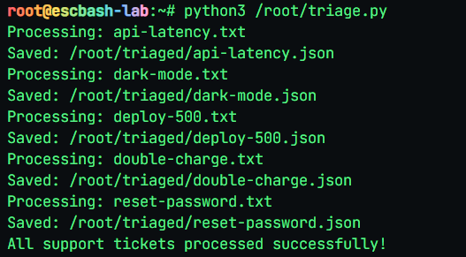
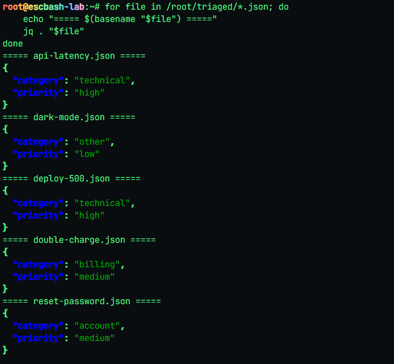
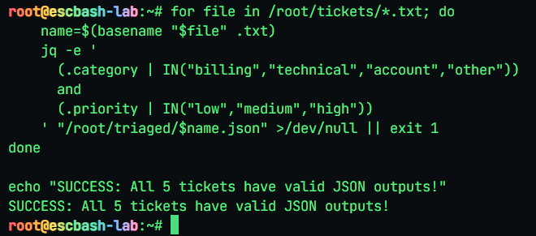

# AI-Powered Support Ticket Triage

Automatically classify support tickets by **issue category** and **urgency** using a DeepSeek model through an OpenAI-compatible API.

  

## Overview

Customer support teams receive many requests. This command-line tool reads every `.txt` ticket, sends its contents to an AI model, validates the returned classification, and saves one machine-readable `.json` record per ticket.

**Pipeline:** `tickets/*.txt` → AI classification → JSON validation → `triaged/*.json`

### Supported labels

| Field | Allowed values |
| --- | --- |
| `category` | `billing`, `technical`, `account`, `other` |
| `priority` | `low`, `medium`, `high` |

### Example

Input: `tickets/deploy-500.txt`

```text
Our production API is returning HTTP 500 for all customers. Checkout is unavailable.
```

Illustrative output: `triaged/deploy-500.json`

```json
{
  "category": "technical",
  "priority": "high"
}
```

## Features

- Batch-processes all `.txt` tickets
- Checks category and priority against allowed values
- Writes formatted JSON with the same base filename
- Handles individual ticket errors without stopping the whole batch
- Uses environment variables rather than hardcoded credentials
- Works with local folders or `/root/tickets` on the lab VM
- Includes unit tests and GitHub Actions CI

## Quick start

Requires Python 3.10+.

```bash
git clone https://github.com/GouthamKoneru/AI_Support_Ticket_Triage.git
cd AI_Support_Ticket_Triage
python3 -m venv .venv
source .venv/bin/activate
pip install -e . -r requirements-dev.txt
```

On Windows PowerShell, activate the virtual environment using `.venv\Scripts\Activate.ps1` instead of `source .venv/bin/activate`.

The lab VM already provides `OPENAI_API_KEY` and `OPENAI_BASE_URL`. On your own machine, copy `.env.example` to `.env` and configure the credentials and provider endpoint. Make sure the environment variables are loaded before running the program. **Never commit `.env` or API keys.**

> **Model compatibility:** `deepseek-v4-flash` is a configurable placeholder based on the chosen model name, not a verified provider model ID. Set `MODEL_NAME` to the exact model identifier supported by your endpoint if different. The endpoint must support OpenAI-compatible Chat Completions.

### Run locally

```bash
triage-tickets --input tickets --output triaged
validate-triage --input tickets --output triaged
```

Or without using the installed CLI entry points:

```bash
python -m ticket_triage.cli --input tickets --output triaged
python -m ticket_triage.validate --input tickets --output triaged
```

### Run on the lab VM

First create the lab's ticket folder (review remote scripts before running them):

```bash
curl -fsSL https://raw.githubusercontent.com/Esc-Bash/project-init-scripts/main/ai/project-1/init.sh | bash
```

Then run:

```bash
triage-tickets --input /root/tickets --output /root/triaged
validate-triage --input /root/tickets --output /root/triaged
```

Optional JSON check using `jq`:

```bash
for f in /root/triaged/*.json; do jq -e '.category and .priority' "$f"; done
```

## Tests

```bash
python -m pytest -q
```

Tests use a fake API client; no real API key, network connection, or paid model requests are needed.

## Project layout

```text
AI_Support_Ticket_Triage/
├── .github/workflows/tests.yml
├── Screenshots/
│   ├── tIcket_processing.png
│   ├── Json_results.png
│   └── validation_success.png
├── src/ticket_triage/
│   ├── __init__.py
│   ├── cli.py
│   ├── core.py
│   └── validate.py
├── tests/test_core.py
├── tickets/                   # Synthetic demonstration tickets
├── triaged/                   # Illustrative JSON records
├── .env.example
├── .gitignore
├── LICENSE
├── pyproject.toml
├── requirements.txt
└── requirements-dev.txt
```

## Limitations and future improvements

Model classifications can be wrong and should be reviewed by a human for high-impact cases. The included sample records are illustrative, not necessarily outputs from a live DeepSeek call. Production extensions could include a review queue, confidence scoring, retries for malformed model responses, PII redaction, analytics, and a dashboard.

## Security

Do not publish real customer tickets, secrets, or private account data. The included sample tickets are fictional. The `.gitignore` excludes `.env` files. Review all changes before pushing to a public repository.

## License

MIT — see [LICENSE](LICENSE).

## Project Execution Screenshots

The following screenshots illustrate the ticket processing, classification results, and validation workflow.

### 1. AI Ticket Processing

The tool processes support tickets and creates individual JSON classification files.



### 2. JSON Classification Results

Each ticket receives an issue category and a priority level.



### 3. JSON Validation Results

The validation step checks JSON structure, allowed labels, and matching output files.


